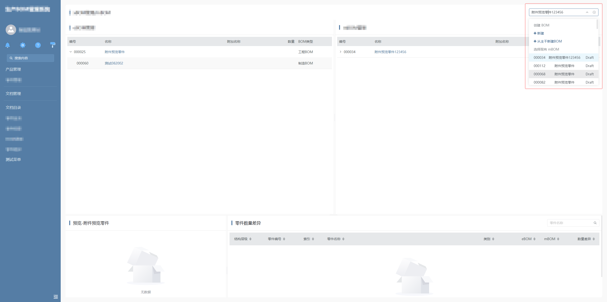

# BOM选择
该插件基于数据选择增强，主要用于重新调整下拉选择弹框内列表行为项与选择项的样式，同时适配界面操作中 “新建数据后立即选中该数据” 的业务逻辑。**该插件隶属于编辑器自定义绘制插件（基于数据选择进行扩展）**


## 页面展示




## 功能说明
### 特殊样式增强
- 下拉弹框内，行为项默认展示在选择项的上方，且行为项的对齐方式与弹框左侧保持一致
- 为行为组与选择列表集合分别添加分组标题：其中，通过 actiontitle 参数可配置行为组的标题，通过 listtitle 参数可配置选择列表集合的标题

### 新增数据默认选中机制
- 当新建行为调用操作完成后，后续界面逻辑将自动执行：把该插件的 value 值及其对应的值项，同步更新为刚新增的数据项，实现新增数据的默认选中效果


## 输入参数

### 编辑器参数

| 参数            | 类型          | 默认值  | 说明 |
| --------------- | ------------ | ------- | --- |
| actiontitle | string | '创建 BOM (mBOM)' | 人员头像文件权限归属实体 |
| listtitle | string | '选择现有 mBOM' | 部门头像文件权限归属实体 |


## 附录

### BOM选择插件

```json
[
  {
    "plugintype": "EDITOR_CUSTOMSTYLE",
    "rtobjectrepo": "@ibiz-template-plmbom/bom-picker@0.0.3-alpha.255",
    "codename": "UsrPFPlugin0826447174",
    "plugintag": "BOM_PICKER",
    "rtobjectmode": 2,
    "rtobjectname": "IBizBomPicker",
    "pssyspfpluginname": "BOM选择"
  }
]
```

### 编辑器样式

```json
[
  {
    "codename": "BOM_PICKER",
    "pssyspfpluginid": "UsrPFPlugin0826447174",
    "repdefault": 0,
    "validflag": 1,
    "pssyseditorstylename": "BOM选择",
    "pseditortypeid": "PICKER"
  }
]
```