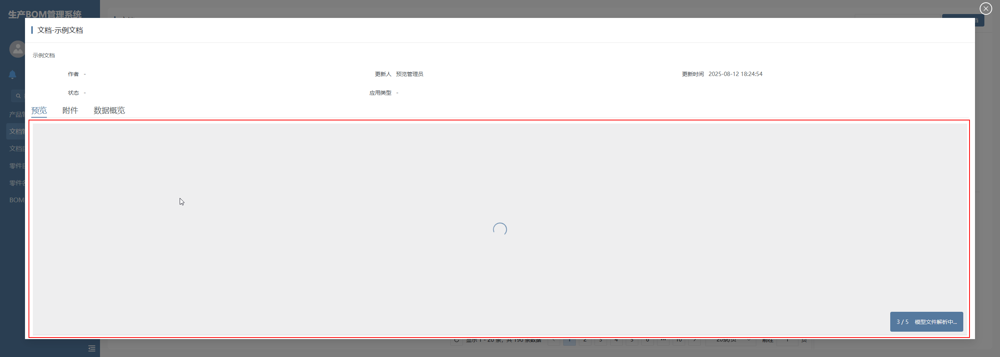
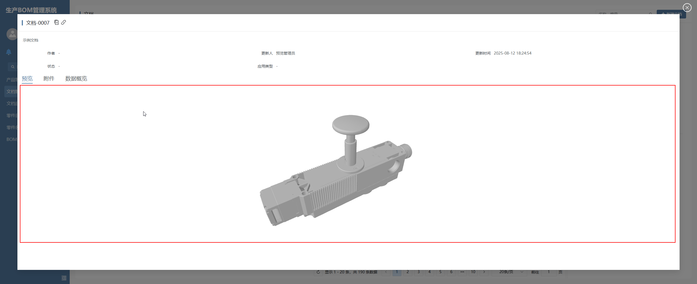

# 3D 模型查看器

该插件用于将3D模型文件转为3D模型并进行查看，该插件基于文件编辑器（单项）进行扩展。

## 页面展示





## 输入参数

| 参数       | 默认值                                                       | 说明                                                         |
| ---------- | ------------------------------------------------------------ | ------------------------------------------------------------ |
| fileConfig | [{type:"IMAGE",title:''},{type:"DOCUMENT",title:''},{type:"MODEL",title:''}] | 默认情况下显示所有类型的文件，但是都不显示标题，可通过编辑器参数自定义要显示哪些类型 的文件，IMAGE表示图片，DOCUMENT表示显示PDF，DOC等文件,MODEL表示显示3D模型。title支持配置${content.xx},${data.xx},${params.xx}等形式做值转换能 |
| showtoolbar | true |  是否显示工具栏,当前只控制图片分类的工具栏 |
| defaultzoom| 1 | 图片默认放大比例，精度支持一位小数
| showHeader | true | 是否显示头部，默认显示 | 配置该参数时必须配置fileConfig, 并且只能配置一个用于显示

## 功能说明

该插件主要有以下几个功能：

\- 将3D文件转为3D模型并呈现在页面上进行查看

\- 可使用鼠标滚轮进行模型的放大缩小，使用鼠标左键进行旋转翻滚，使用鼠标右键进行平移拖动

注：该插件暂时只支持3D模式整体模型查看

## 附录

### 编号标题栏插件

\```

\```